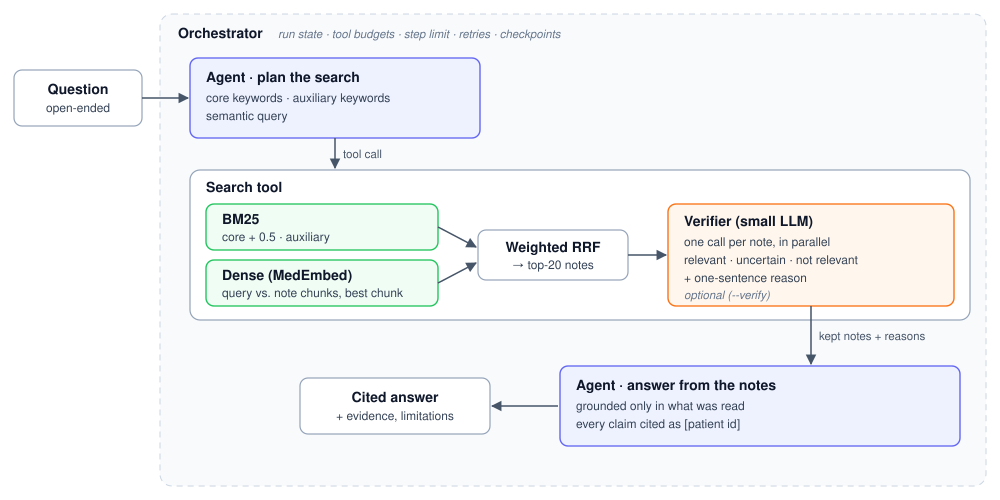

# PatientInsight

A clinical research agent that answers complex, open-ended questions over a large corpus of patient
notes. It plans its own search, retrieves evidence across many patients, screens what it retrieved, and
writes an answer in which every claim is cited to a specific patient.

## Data

The corpus is **Asclepius Synthetic Clinical Notes**
([Kweon et al., *Findings of ACL 2024*](https://aclanthology.org/2024.findings-acl.305)): about **158K
synthetic discharge summaries**, one per patient, generated from publicly available case reports
(Hugging Face: `starmpcc/Asclepius-Synthetic-Clinical-Notes`, CC BY-NC-SA 4.0). Synthetic notes let the
whole pipeline be built and shared without real patient data.

Two query sets, both corpus-level (each question has many relevant patients):

| Set | Size | Example |
|---|---|---|
| **Temporal** (`general_temporal_queries/`) | 100 | *What was the timeline of events related to liver abscesses, from initial diagnosis through treatment, recovery, and discharge?* |
| **Cohort** (`cohort_queries/`) | 20 | *Patients with diabetic ketoacidosis treated with an insulin infusion.* |

Temporal queries were mined from the dataset's temporal-information-extraction questions and rewritten
from patient-specific into corpus-level questions. Cohort queries use 1–2 criteria (diagnosis,
medication, procedure) and range from ~50 to ~5,000 candidate patients.

## Architecture



A single agent plans the search and writes the answer; the **orchestrator** (plain Python) runs the loop
and owns everything that should not be left to the model: run state, tool-call budgets, step limits, a
forced final answer, error handling, and checkpoints.

**Keyword planning.** The agent turns the question into
- **core keywords**: the entities in the question (*liver abscess*, *percutaneous drainage*);
- **auxiliary keywords**: terms likely to appear in relevant notes but not in the question
  (abbreviations, related tests, treatments, complications);
- a **semantic query**: one or two plain sentences describing what a relevant note contains.

**Hybrid search.** Two retrievers rank all patients:
- **BM25** over keywords: `BM25(core) + 0.5 · BM25(auxiliary)`;
- **dense retrieval** with [MedEmbed](https://huggingface.co/abhinand/MedEmbed-base-v0.1) over 300-word
  note chunks; a patient's score is its best-matching chunk.

The two rankings are fused with weighted reciprocal rank fusion, which uses ranks only, so the two
retrievers' scores never need calibrating:

$$\text{score}(p) = \sum_{r \in \{\text{bm25},\,\text{dense}\}} \frac{w_r}{k + \text{rank}_r(p)}, \qquad w_{\text{bm25}} = 1,\ w_{\text{dense}} = 0.5,\ k = 60$$

**Verifier.** A small, cheap LLM screens each of the top-20 notes before the agent reads them (one call per
note, in parallel). Each note gets a label (*relevant*, *uncertain*, *not relevant*) and a one-sentence
reason. Dropped notes never reach the agent; kept notes carry their reason as a pointer to the relevant
part. The goal is a cleaner context: fewer irrelevant patients to misuse, and less to read. The verifier's
model is configurable (any OpenAI-compatible endpoint, including a local vLLM server), and its token cost
is tracked separately from the agent's.

## Evaluation

Both levels use an LLM judge (a stronger model than the agent).

**Retrieval.** The judge labels every retrieved (query, patient) pair as relevant or not; judgments are
cached and shared across systems (pooling). Metrics: **P@5/10/20**, **nDCG@20**, **pooled recall@20**, and
gold-patient recall.

| System (100 temporal queries) | P@5 | P@20 |
|---|---|---|
| BM25, raw question | 0.602 | 0.548 |
| Dense, raw question | 0.710 | 0.647 |
| BM25, agent-planned keywords | 0.800 | 0.749 |
| **Hybrid** (agent keywords + dense, RRF) | **0.836** | **0.775** |

**Answers.** Each query set has a rubric per query: general criteria (grounding, temporal precision,
patient attribution, …) plus query-specific ones, each with signed points (rewards and penalties).
The judge marks which criteria hold for an answer; with $A$ the applicable criteria and $p_i$ their points,

$$\text{score} = \operatorname{clip}\!\left(\frac{\sum_{i \in A,\ \text{holds}} p_i}{\sum_{i \in A,\ p_i > 0} p_i},\ 0,\ 1\right)$$

## Running

Setup: Python 3.9+, `pip install openai pandas pyarrow numpy bm25s PyStemmer tqdm torch
sentence-transformers transformers`, an OpenAI key in `openai_secret.txt` (git-ignored), and the dataset
downloaded with `asclepius_data.ipynb` (Part 1).

```bash
# indexes (dense needs a GPU or Apple MPS; resumable)
python bm25_search.py --build
python dense_search.py --build --model medembed-base

# agent
python orchestrator.py --one 0 --verify             # one query, print everything
python orchestrator.py --verify --tag hybrid-verified
python orchestrator.py --queries data/asclepius/cohort_queries/cohort_queries.jsonl

# evaluation
python judge_answers.py results/<run>/<run>.jsonl
python judge_retrieval.py --systems results:<run.jsonl> dense:medembed-base hybrid:<run.jsonl>

# tests (fake models, no API calls)
python test_orchestrator.py
```

| `orchestrator.py` flag | Default | |
|---|---|---|
| `--search` | `hybrid` | `hybrid` or `bm25` |
| `--verify` | off | screen notes with the verifier |
| `--verifier-model` | `gpt-5.4-nano` | add `--verifier-base-url`, `--verifier-api chat`, `--verifier-effort none` for a local model |
| `--w-dense`, `--rrf-k`, `--depth` | `0.5`, `60`, `100` | hybrid fusion settings |
| `--max-searches` | `1` | search calls per question |
| `--queries`, `--limit`, `--tag`, `--resume` | | query file, first N, run label, continue a run |

Each run writes `results/<timestamp>_<model>_<tag>/` with one line per query (answer, retrieved and shown
patients, token usage of agent and verifier) and a `config.json` recording models, settings, prompts and
the git commit. Answer grades are saved next to the run in `judge_<model>/`.
